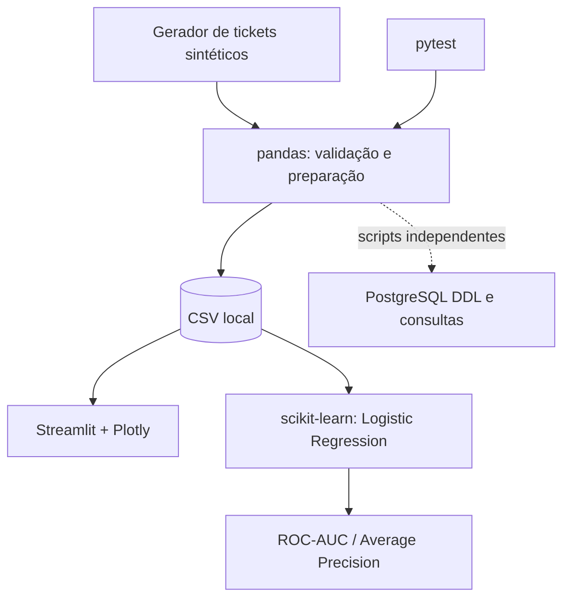

# Arquitetura e fluxo de dados

## Arquitetura do MVP

## Responsabilidades dos arquivos
- `src/pipeline.py`: geração, validação, KPIs e criação/leitura do CSV.
- `src/model.py`: features, transformação categórica, baseline supervisionado e métricas.
- `app.py`: UI de análise e filtros.
- `sql/schema.sql`: contrato relacional ilustrativo.
- `sql/analysis.sql`: análises SQL demonstrativas.
- `tests/test_pipeline.py`: verificações automatizadas.
- `requirements.txt`: dependências Python.

## Decisões arquiteturais
**ADR-001 — Dados sintéticos:** demonstrar competências evitando exposição de dados sensíveis. Consequência: métricas não generalizam para operações reais.

**ADR-002 — CSV local no MVP:** reduzir infraestrutura para executar rapidamente. Consequência: sem múltiplos usuários, transações, catálogo ou trilha de carga persistente.

**ADR-003 — Baseline interpretável:** regressão logística como referência inicial antes de modelos complexos. Consequência: comparar com prevalência, calibrar e testar drift antes de qualquer uso operacional.

**ADR-004 — Separação temporal:** treinamento nas primeiras 80% observações por data/ticket, teste nos últimos 20%. Consequência: aproxima avaliação prospectiva, mas não elimina todo vazamento e não substitui rolling-origin validation.

## Segurança e riscos
Não armazenar PII ou segredos no repositório. Antes de dados reais: controle de acesso, classificação dos dados, mascaramento, retenção, logs, consentimento/base legal e revisão jurídica da LGPD.

## Arquitetura-alvo — não implementada
`Data source -> ETL versionado -> PostgreSQL -> Camada semântica/KPIs -> Modelos NLP e preditivos -> Dashboard e alertas`, com Docker, CI e observabilidade.
